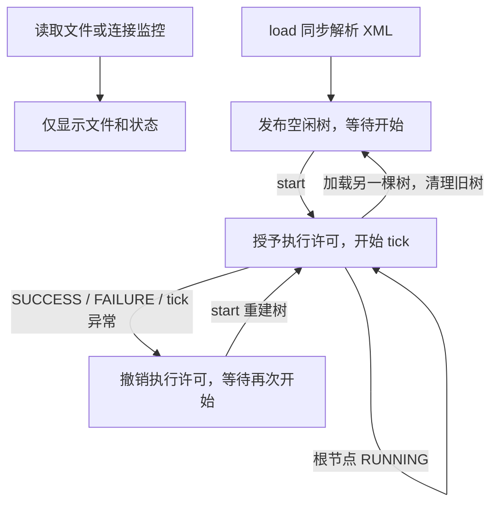

# BehaviorTreePlugin

本项目构建一个集成行为树监控功能的 `BehaviorTreePlugin` 动态插件。

当前加载、开始、ACT 自动结束和异常处理的完整流程见[运行逻辑总览](#运行逻辑总览)。

顶层 `CMakeLists.txt` 通过 `add_subdirectory(monitor)` 引入监控子目录；
`monitor/CMakeLists.txt` 使用 `target_sources` 将监控源码加入已有的
`BehaviorTreePlugin` 目标。监控功能不会生成第二个动态库，最终只需部署
一个 `libBehaviorTreePlugin.so`。

## 依赖安装

### 依赖结论

监控代码直接接收 `BTManager` 中 `StatusObserver` 产生的节点
状态回调，不再轮询 `Groot2Publisher` 的 1667 端口。监控组件
本身没有新增必须安装的外部系统库。事件消费任务通过
`PluginBase::start_managed_worker()` 交给 xplugin Host 托管，monitor
不创建 `std::thread`，也不单独链接 `Threads::Threads`。

主行为树插件仍然创建 `Groot2Publisher` 供 Groot2 调试工具使用，
因此完整编译该项目时仍然需要 **ZeroMQ (`libzmq`)**；它不再是
monitor 的直接依赖。

Ubuntu/Debian 构建环境可安装：

```bash
sudo apt update
sudo apt install -y \
  build-essential \
  cmake \
  libzmq3-dev
```

包用途：

| 软件包 | 是否必需 | 用途 |
| --- | --- | --- |
| `build-essential` | 是 | 提供 GCC/G++、标准 C/C++ 头文件和基本构建工具。 |
| `cmake` | 是 | 配置主插件及 `monitor` 子目录。项目要求 CMake 3.14 或更高版本。 |
| `libzmq3-dev` | 完整插件必需 | 供 BehaviorTree.CPP 的 `Groot2Publisher` 使用；monitor 不再直接调用它。 |

### 由部署环境提供的主插件依赖

以下两项不是 monitor 新增的依赖，但构建完整
`BehaviorTreePlugin` 时必须已安装，并且能被 CMake 找到：

| CMake 包/目标 | 用途 |
| --- | --- |
| `xplugin-dev` / `xplugin::sdk` | 提供插件生命周期、日志、HTTP 端点和 WebSocket 端点 API。 |
| `gateway_proto` / `gateway_proto::gateway_proto` | 提供行为树插件使用的系统状态 Protobuf 消息。 |

如果它们安装在非标准目录，通过 `CMAKE_PREFIX_PATH` 指定 CMake
包路径：

```bash
cmake -S . -B build \
  -DCMAKE_BUILD_TYPE=Release \
  -DCMAKE_PREFIX_PATH="/path/to/xplugin;/path/to/gateway_proto"
```

### 项目已内置，无需单独安装

| 依赖 | 来源 | 用途 |
| --- | --- | --- |
| BehaviorTree.CPP 4.9.0 | `3rd/BehaviorTree.CPP-4.9.0` | 行为树执行以及 `Groot2Publisher`。 |
| cppzmq | BehaviorTree.CPP 的 `3rdparty/cppzmq` | 供主插件中的 `Groot2Publisher` 使用，monitor 不直接使用。 |
| tinyxml2 | BehaviorTree.CPP 的 `3rdparty/tinyxml2` | 解析行为树 XML 和 `bt_nodes.xml`。 |
| fmt 11.2.0 | `3rd/fmt-11.2.0` | 格式化监控日志。 |
| nlohmann/json | 项目头文件/现有依赖 | 生成 HTTP 响应和 WebSocket JSON 消息。 |

不需要额外安装系统 `cppzmq-dev`、`libtinyxml2-dev`、`libfmt-dev`
或 `nlohmann-json3-dev`，否则可能与项目中固定的版本混用。

### 依赖检查

构建前可以检查 ZeroMQ 头文件和动态库：

```bash
test -f /usr/include/zmq.h && echo "zmq.h: found"
ldconfig -p | grep libzmq
```

CMake 配置成功时应出现类似信息：

```text
Found Threads: TRUE
Found ZeroMQ: /usr/lib/x86_64-linux-gnu/libzmq.so
```

构建完成后可检查最终插件是否存在缺失的运行时库：

```bash
ldd /path/to/plugins/libBehaviorTreePlugin.so | grep "not found"
```

该命令没有输出才表示所有动态库都能正常解析。

## 构建

在项目根目录执行：

```bash
cmake -S . -B build -DCMAKE_BUILD_TYPE=Release
cmake --build build --parallel
```

构建完成后会生成包含主行为树功能和监控功能的：

```text
build/libBehaviorTreePlugin.so
```

默认输出目录是 CMake 构建目录。可以在配置时通过
`RPC_GATEWAY_PLUGIN_OUTPUT_DIR` 指定 rpc_gateway 的插件目录：

```bash
cmake -S . -B build \
  -DCMAKE_BUILD_TYPE=Release \
  -DRPC_GATEWAY_PLUGIN_OUTPUT_DIR=/home/codeit/Desktop/rpc_gateway/current_version/plugins

cmake --build build --parallel
```

重新编译和替换 `.so` 后，必须完整重启 rpc_gateway，已加载的动态库
不会因为文件被覆盖而自动刷新。

## 部署结构

推荐部署结构：

```text
current_version/
├── bin/
│   └── rpc_gateway
├── bt_trees/
│   ├── bt_nodes.xml
│   └── move_test.xml
├── plugins/
│   └── libBehaviorTreePlugin.so
└── static/
```

当前行为树主插件及 monitor 均使用 `../bt_trees` 相对路径。因此
rpc_gateway 应当从 `current_version/bin` 作为工作目录启动。

## 行为树 XML 读取接口

`read` 保持原有的文件列表功能：

```text
POST /backend/plugin-http/behavior_tree/read
```

读取指定行为树 XML 使用独立的 `read.xml` 接口：

```text
POST /backend/plugin-http/behavior_tree/read.xml
```

请求：

```json
{
  "file": "move_test.xml"
}
```

成功响应：

```json
{
  "data": {
    "file": "move_test.xml",
    "content": "<root BTCPP_format=\"4\">...</root>"
  },
  "request_code": 0,
  "request_message": "ok",
  "request_source": "plugin"
}
```

该接口只允许读取 `bt_trees` 目录内的 `.xml` 普通文件，绝对路径和
`../` 越界路径会被拒绝。

## SetActSocketInference 命令节点

行为树节点 `SetActSocketInference` 通过现有的
`main.handler.req.dyncmd` 请求接口下发驱动命令：

```text
{SetActSocketInference --update_enable=1 --send_enable=1}
```

对应的行为树写法：

```xml
<SetActSocketInference robot_sel="0;1" update_enable="1" send_enable="1"/>
```

`update_enable` 和 `send_enable` 都是整数开关，只允许 `0` 或 `1`，
默认值均为 `1`。`robot_sel` 沿用其他动作节点的机器人索引列表格式，
默认 `0;1`；单机器人配置应显式填写 `robot_sel="0"`。

节点会检查驱动连接、模型状态和机器人索引，使用当前模型数量构造
`event_name="SetActSocketInference"`、`user_action="Click"` 的动态命令，
并把两个开关放入所选模型的 `sub_commands` 字段。
请求在等待期间返回 `RUNNING`，收到成功业务响应后返回 `SUCCESS`；
参数错误、请求失败、10 秒超时或连接断开时返回 `FAILURE`，halt 时取消等待。
取消等待不撤销已经由驱动执行的命令。

单独的示例树见 `tests/trees/set_act_socket_inference.xml`。示例使用
`update_enable="1" send_enable="0"`，允许更新并关闭持续下发。
示例使用
`RunOnce then_skip="false"` 包住 `Sequence`：设置命令成功后进入下一个节点，
失败则停止序列；`RunOnce` 在当前树实例中缓存执行结果。
将 `AlwaysSuccess` 占位节点替换成实际的下一个动作即可。整棵树结束后，管理器等待
下一次显式开始；再次开始会重建树，允许重新执行。
下游驱动需要已支持 `SetActSocketInference` 命令；本插件负责转发及检查响应。

管理器 C++ `start()` 默认周期为 50 ms，HTTP `/start` 未指定 `period` 时使用
1000 ms；两种入口都支持完成通知触发的即时 tick。
异步 JSON 命令节点在请求成功或失败时唤醒管理器，
无需等待下一个周期才推进序列。暂停时通知不会触发执行，恢复后处理已完成的请求。
该优化缩短请求响应后的调度等待；`SetActSocketInference` 的成功仍表示驱动命令成功响应，
是否已完成推理由驱动响应语义决定。

### 启动报 prepare cancelled / -40 的排查

2026-11-03 现场日志中，驱动收到的是无参数命令
`{SetActSocketInference||NotRunExecute}`。驱动先在 model 0 返回
`-2: specify update_enable and/or send_enable (0 or 1)`，再在 model 1 返回
`-40: prepare cancelled`。网关最后显示的 `-40` 是后续通道取消信息；应同时核对
驱动日志中更早的准备异常。启动和停止请求都可能因相同的参数丢失而失败。

此次根因是网关 `config/event_command.json` 中该事件的 `args` 被置为 `{}`，
插件放在 `sub_commands` 的启停开关、实例名和监督参数没有进入驱动命令。
恢复该事件的 12 项参数映射即可，保留 `allowed_status=[0]`。无需因此放宽准入、
增加等待超时或重编译插件。参数为空的具体原因尚未确认。

[修复请求](../act-gripper-change/act-event-args-repair.json) 使用本次现场的命令 UUID，
可在网关事件管理页的原始请求入口提交 `UpdateCommand`。
也可离线修复配置文件（默认仅检查差异）：

```bash
python3 ../act-gripper-change/repair-act-event-args.py
# 退出网关后，以有权限的账号备份并修复，再启动网关加载配置：
python3 ../act-gripper-change/repair-act-event-args.py --apply
```

脚本仅修改该事件的 `args`，拒绝覆盖已经变化的 UUID、准入规则或非空参数，
并在应用前备份原文件。检查和修复均不启动行为树、不发送 ACT 动作；
真实启动是否成功仍需在加载配置后验证。

## RunActSocketInferenceOnce 单步节点

每次激活发送一次 `RunActSocketInferenceOnce` 指令，由驱动自动关闭连续更新和下发，再完成一次更新、推理和动作提交，无需前置 `SetActSocketInference` 节点：

```xml
<RunOnce then_skip="false">
  <RunActSocketInferenceOnce/>
</RunOnce>
```

显式开始后，管理器在本轮运行期间 tick 行为树；外层 `RunOnce` 缓存该节点的执行结果。
整棵树成功或失败后等待下一次开始，再次开始会重建树并重置缓存。需要在循环或序列中
逐步执行时，可直接使用内层动作节点，每次激活提交一次请求。

可指定模型通道、驱动超时和 ACT 实例名称：

```xml
<RunActSocketInferenceOnce robot_sel="0" timeout_ms="10000"
                          subsystem_name="ActSocketInference#0#0"/>
```

`robot_sel` 默认 `0`，只允许选择一个模型通道。单条 ACT 指令已经同时控制其配置中的机械臂和夹爪，选择 `0;1` 会被拒绝，避免重复触发。`timeout_ms` 必须为正，默认 `10000`；`subsystem_name` 默认留空，由驱动查找唯一 ACT 实例。

节点通过 `main.handler.req.dyncmd` 发送 `event_name="RunActSocketInferenceOnce"`、`user_action="Click"`，将参数放入选中模型的 `sub_commands`。下游动态命令映射需支持该事件以及 `timeout_ms`、`subsystem_name` 参数。等待响应时返回 `RUNNING`，不会重复发送；驱动成功响应返回 `SUCCESS`，业务错误、连接断开或请求超时返回 `FAILURE`。请求等待时间为 `timeout_ms + 2000` 毫秒，为驱动响应保留传输时间。halt 取消本地等待，不撤销已经交给驱动的动作。

示例树见 `tests/trees/run_act_socket_inference_once.xml`。节点注册后会随其他节点一起出现在生成的 `bt_nodes.xml` 中。

## RunActUntilGripperDone 连续运行节点

示例树见 `tests/trees/run_act_until_gripper_done.xml`。节点启动 ACT 时，将夹爪完成条件
交给 ACT 子系统：`finish_on_gripper=1`、`closed_mm`、`finish_opening_mm`、
`tolerance_mm`、`closed_stable_ms`、`stable_ms`、`feedback_timeout_ms`。
子系统在命令锁内读取挂载夹爪的 YSEG2 子系统实际开度，确认本轮闭合并稳定重新张开后，关闭推理和
下发开关，取消本轮网络等待。超时、反馈异常或推理/下发故障也会结束本轮。
初始闭合不计为本轮闭合；必须先出现非闭合反馈。初始张开不能直接完成任务。

行为树直接读取 `overall_system_nrtstate.subsystem[].data` 中的
`ActSocketInferenceData`，不发送 `ShowActSocketInferenceData` 查询指令。
载荷仍为 248 字节，原保留状态字现为带版本标记的 `run_state`。
正常完成必须属于本轮，且推理、下发开关均已关闭，随后节点返回成功。
该路径不再发送网关停止命令，因此保持 `SetActSocketInference` 仅空闲可执行的规则。
驱动、插件及网关参数映射需一起更新，并执行 `UpdateFuncPoolXml` 更新命令参数声明。

`subsystem_name` 留空时选择唯一 ACT 实例，并将解析出的名称用于启动和停止命令；
有多个实例时必须明确指定。启动回执之后，节点在 `command_timeout_ms` 内等待本轮
运行状态发布，旧的缓存状态不能授权完成。`feedback_timeout_ms` 同时约束 RT 和
NRT 消息的新鲜度。子系统已停止的故障轮次直接返回失败；缺失、格式不兼容或停止推进
的消息仍触发原有异常停止流程，halt 也保留原有停止请求。网关可能拒绝执行中的这些
外部停止请求，子系统本轮监督和 `run_timeout_ms` 继续生效。

反馈新鲜度由 `BTManager::update_rt/update_nrt` 在消息接收时记录，分别保留接收时间、
帧头最后推进时间和计数回退次数。相同帧头的重复消息不刷新推进时间，tick 之间发生后
又恢复的计数回退也会保留。行为树按这些接收侧快照判断反馈，不能把两次 tick 的间隔
当成反馈间断；默认 1000 ms 的树周期与 1000 ms 反馈时限可以同时使用。
等待首条本轮 NRT 状态期间也持续检查 RT 接收状态。

异常进入停止流程前，会记录 `first failure`，包含阶段、RT/NRT 消息与推进年龄、
计数、实例和运行代次。停止被拒绝或超时后，输出 `phase=stop_unconfirmed`，
`error` 同时保留首次失败原因和停止未确认信息，不立即重复发送同一停止请求。

ACT 节点的回归测试使用模拟请求及状态消息，不连接机器人。启用并运行：

```bash
cmake -S . -B build -DBT_PLUGIN_BUILD_TESTS=ON
cmake --build build --parallel
ctest --test-dir build --output-on-failure
```

`bt_scheduler_wakeup` 使用模拟请求，将周期设为 5 秒，验证完成通知在 500 ms 内
推进下一节点，并覆盖同步完成、暂停恢复、切树后旧请求返回和失败通知。

## 运行逻辑总览

加载与执行的隔离全部在 `BehaviorTreePlugin` 内实现。插件初始化时注册接口、订阅
驱动连接与 RT/NRT 状态、生成节点模型并准备监控；不会因此启动 ACT。
HTTP 接口前缀为 `/backend/plugin-http/behavior_tree`，下面用 `/load` 等简称。

### 从加载到本轮结束



1. **加载**：`/load` 先撤销旧执行许可，停止并等待旧 tick 线程退出，再 halt 旧树，
   同步解析选中的 XML，创建观察器并发布带 UID 的空闲快照。新树此时没有执行许可，
   不会激活 ACT 节点。旧树若仍在运行，其 halt 清理可能发送原有停止请求。
2. **开始**：只有 `/start` 授予执行许可并启动 tick。正在执行时重复开始保持幂等，
   不再提交一轮动作。首次开始使用已加载的树；上一轮已经结束时重建树，重置
   `RunOnce` 等节点缓存。
3. **推进**：动作请求异步等待并返回 `RUNNING`，不因每次 tick 重复下发。
   默认 HTTP 周期为 1000 ms，请求完成通知可以提前唤醒 tick；RT/NRT 状态接收独立进行。
4. **结束**：根节点返回 `SUCCESS`、`FAILURE` 或 tick 抛异常后，插件记录本轮结束，
   撤销执行许可并暂停。异常还会尝试 halt 清理。后续回调只能通知调度，不能自行开始
   新一轮；下一次显式 `/start` 才能重新执行。

`load/start/stop` 通过生命周期锁串行处理。解析非法 XML 会返回加载错误并清理树，
保持未授权执行状态，不会回退运行旧树。

| 操作 | 当前处理 |
| --- | --- |
| 读取、保存 XML，连接监控或读取快照 | 不授予执行许可，不启动新树。 |
| `/load` | 替换并展示树，等待显式开始。 |
| `/start` | 开始一轮；活动轮次中重复调用不重复启动。 |
| C++ `pause()` | 暂停 tick，保留未完成轮次的执行许可与待处理请求。 |
| C++ `resume()` | 仅恢复已获许可的未完成轮次；刚加载或已经结束时无效。 |
| C++ `step()` | 暂停后单次 tick；没有执行许可时返回 `IDLE`。 |
| `/stop` | 撤销许可、结束 tick 线程并 halt 清理树；保留所选文件供下次开始重建。 |

这里的“显式开始”指收到 `/start` 调用，页面或其他客户端调用该接口都属于显式开始，
插件不能据此证明用户点击了页面按钮。日志 `[BT HTTP]` 记录路由、`request_id`、`Origin`、
`Referer` 和 `User-Agent`，可用于排查调用来源；URL 去除查询和片段，字段限长并清除换行。

### test3.xml 的 ACT 连续运行过程

现场树为 `RunOnce → RunActUntilGripperDone`。节点和 ACT 子系统分工如下：

1. **行为树检查并启动**：检查驱动连接、参数、机械臂及夹爪使能状态，以及新鲜的
   RT/NRT 数据。`subsystem_name` 留空时解析唯一 ACT 实例，记录启动前的运行代次，
   然后通过 `main.handler.req.dyncmd` 发送一次 `SetActSocketInference`，打开更新与
   下发，同时交付夹爪条件和 `run_timeout_ms`。
2. **等待本轮状态**：命令成功回执只表示启动请求成功。节点继续在
   `command_timeout_ms` 内等待本轮 NRT 运行状态；旧缓存完成状态不能结束新一轮。
3. **子系统监督夹爪**：ACT 在框架命令锁内读取挂载夹爪的 YSEG2 子系统实际开度，先观察到非闭合，
   再观察闭合并稳定保持，随后等待重新张开并稳定保持。现场条件为先闭合到
   `≤30 mm` 保持 `200 ms`，再张开到 `65±1 mm` 保持 `500 ms`。
   夹持成功只进入 `WaitingOpen`，ACT 继续搬运和放置；不会因夹住物体返回原位。
   初始张开不能直接完成；新版启动要求实体夹爪已在最终张开位置。
4. **子系统自行结束**：满足条件后，子系统发布 `Completed`，关闭更新与下发开关，
   作废本轮结果并取消网络等待。运行超时、反馈故障或检测到推理/下发故障时，
   同样关闭开关并发布相应失败状态。以后再次启动会重新连接，旧响应不能进入新一轮。
5. **行为树确认结果**：直接读取 `overall_system_nrtstate.subsystem[].data` 中
   248 字节的 `ActSocketInferenceData`，核对实例、运行代次、`run_state` 和两个开关。
   本轮 `Completed` 且两个开关均为 `0` 时返回 `SUCCESS`；本轮故障终态且开关已关闭时
   返回 `FAILURE`。正常完成不发送外部停止命令，也不发送 `ShowActSocketInferenceData`。

RT/NRT 新鲜度在消息接收时记录，同时检查接收时间、帧头推进时间和计数回退。
重复帧不能刷新推进时间，两次树 tick 相隔较久也不会被直接当成反馈中断。
夹爪稳定时间只随夹爪子系统的新发布推进，同时监测 RT 计数是否推进。现场完整参数见
[部署记录中的 test3.xml 参数](../act-gripper-change/README.md#test3xml-参数)。

节点输出 `phase` 依次可见 `starting`、`waiting_status`、`waiting_close`、
`waiting_open` 和 `done`；故障可见 `failed`，进入外部停止流程时为 `stopping`，
停止被拒绝或超时则为 `stop_unconfirmed`。`opening_mm` 输出夹爪模型开口，
`error` 保存错误原因。

### 异常与停止的含义

网关 `SetActSocketInference` 的 `allowed_status=[0]`（仅空闲可执行）保持不变。
行为树检测到反馈失效、轮次变化、任务超时等异常，或运行节点被 halt 时，仍保留
原有外部停止请求；执行中可能被网关拒绝。节点运行异常进入停止流程前记录
`first failure` 和状态上下文，停止失败时保留首因并输出 `stop_unconfirmed`，
不立即重复发送同一停止请求。halt 清理最多等待外部停止回执 500 ms。
子系统本轮监督与运行时限继续生效。驱动断连或网关进入错误状态时，插件会停止
活动树；插件退出时也会撤销许可并清理线程。

暂停 tick 不会关闭 ACT；行为树停止或返回失败也不能单独证明 ACT 已停止。
子系统关闭两个开关可阻止后续 ACT 下发，不撤销已经提交的运动。当前完成判定使用
夹爪子系统发布的 `actual_pos`，虚拟夹爪模型目标不参与空抓或正常结束判定。
`opening_mm` 输出仍为模型开口诊断值，不用于上述判定。

### 对应源码与验证

| 逻辑 | 源码 |
| --- | --- |
| 插件初始化、状态订阅、HTTP 加载/开始/停止和调用日志 | [source/behavior_tree_plug.cpp](source/behavior_tree_plug.cpp) |
| 执行许可、切树、tick 调度、结束等待与状态接收时间 | [source/bt_manager.cpp](source/bt_manager.cpp)、[include/bt_manager.hpp](include/bt_manager.hpp) |
| ACT 启动、直接读取状态、本轮结果确认和异常停止 | [source/run_act_until_gripper_done.cpp](source/run_act_until_gripper_done.cpp) |
| 子系统监督、开关关闭与状态发布 | [act_socket_inference.cpp](../codeit-deploy/subsystem_module/wang_qp/act_infer/act_socket_inference.cpp) |
| 实体夹爪开度读取与发布推进检查 | [act_gripper_feedback.hpp](../codeit-deploy/subsystem_module/wang_qp/act_infer/act_gripper_feedback.hpp) |
| 夹爪闭合与重新张开判定 | [act_gripper_monitor.hpp](../codeit-deploy/subsystem_module/wang_qp/act_infer/act_gripper_monitor.hpp) |

当前七项离线回归测试已通过：`set_act_socket_inference`、`run_act_socket_inference_once`、
`run_act_until_gripper_done`、`bt_scheduler_wakeup`、`bt_explicit_start`、`move_absj_joint_target`、
`act_grasp_retry`。
测试使用模拟请求与状态；生命周期测试关闭 Groot2 监听端口，未发送真机动作。
真机完成行为尚需现场验证。更新 `.so` 后需完整重启网关才能使用新逻辑。

## 小于 5 mm 失败后回位重试，以及启动前原位检查

配套使用更新后的 Codeit 1.3.52 驱动和本插件：

- [test3-grasp-retry.xml](tests/trees/test3-grasp-retry.xml)：抓取失败则回位重试，成功完成一次后回位结束。
- [test3-grasp-retry-loop.xml](tests/trees/test3-grasp-retry-loop.xml)：成功后继续下一轮，抓取失败则恢复后重试。

每次尝试的顺序为：确认 `pick_home` → 确认夹爪张开 → 启动 ACT。
原位判断比较 NRT 命名目标与 RT 各轴位置，默认误差 ≤0.01 rad、速度 ≤0.01 rad/s，
网关空闲且模型无活动运动，观测保持 200 ms。`skip_if_at_target="true"` 时已经在位
直接通过，否则提交一次回位并确认到位。目标缺失或反馈异常在启动 ACT 前退出。

夹爪张开使用同一个运动节点，选择 `robot_sel="1"`，设置
`jointtarget_values="0.065"`（单位 m，即 65 mm），位置容差为 0.001 m，
速度阈值为 0.001 m/s；本例对应单轴直线夹爪模型。多关节显式值用分号分隔。
新树的夹爪张开节点设置
`feedback_subsystem="TwoFingersGripperSerialYSEG2#0#1"`，用该子系统的实际开度
确认到位和跳过条件；模型到达 65 mm、实体夹爪还未到位时继续等待，不启动 ACT。
此可选端口只支持挂载到所选单轴模型的 YSEG2；更换实例时同步修改该名称。
速度检查仍使用模型反馈，实体开口需在目标容差内持续保持指定时间。
显式值模式复用现有 `MoveAbsJVar` 网关事件，`jointtarget_value` 按 Codeit 格式补齐
十个槽位，未选模型保持不执行。两种运动模式都先等待空闲，不修改网关准入规则。
已经张开且稳定时同样跳过运动。`jointtarget_values` 留空时仍按命名目标工作。
历史端口 `position_tolerance_rad` / `velocity_tolerance_rad_s` 对直线轴按 m / m/s 解释。

ACT 子系统自动绑定 `model()==gripper_model` 的唯一 YSEG2 子系统，在数据保护锁内
读取 `TwoFingersGripperSerialYSData.actual_pos`（单位 m，乘 1000 得 mm）。
找不到匹配实体反馈、匹配不唯一或载荷不兼容会拒绝启动，不回退使用虚拟模型目标。
旧版误把模型闭合到 0 当成实体空抓，即使已夹住物体也可能提前回位；此版修正该数据来源。

`GripperCompletionMonitor` 仅在实际开口严格小于 5 mm 并持续 `closed_stable_ms`
（例中 200 ms）时标记 `GraspFailed=0x41430007`。等于 5 mm 不触发；单帧低值或
中途恢复到 ≥5 mm 会清除本次低值计时。启动时还会核对实体夹爪已张开到设定位置。
**成功夹住物体不是 ACT 完成**：实际闭合稳定后只进入 `WaitingOpen`，ACT 继续搬运、
放置；实际重新张开到 `65±1 mm` 并保持 500 ms 后才发布 `Completed`，随后回位。
非有限值、负值、反馈过期或计数回退属于反馈故障。终态锁存到下一轮。
子系统在命令锁内关闭推理与下发开关、作废本轮结果并取消网络等待。
NRT 载荷仍为 248 字节，`run_state` 仍位于偏移 44；没有新增 Set 命令参数。

`RunActUntilGripperDone` 只有核对本轮 `GraspFailed` 且两个开关均关闭后，才输出
`result=grasp_failed` 并返回 `FAILURE`。正常完成输出 `completed`，其他失败输出
`fault`，halt 输出 `canceled`。在启动验证前会清除上轮结果。

新增控制节点 `RetryActGrasp` 必须有两个孩子：第一个是原位检查、夹爪张开和 ACT
组成的尝试序列，第二个是失败后的回位节点。它只捕获 `grasp_failed`；先确认回位，
再从原位检查、张开夹爪开始下一次尝试。各尝试开始前清除共享结果，避免前置检查
失败时复用旧的抓取失败标记。回位失败、张开失败、`-501`、未使能、超时、断连、
反馈故障或停止未确认都退出；不会自动清错、使能或重复提交不确定的运动。

`max_attempts="-1"` 表示持续重试；正整数为最大尝试次数，达到上限仍先恢复原位，
然后输出 `retry_exhausted` 并失败退出。`result="{act_result}"` 必须与 ACT 节点的
输出绑定同一个黑板键。`retry_phase` 为 `attempting/recovering/done/failed/halted`。
外层 `Repeat` 负责成功任务间循环，`RetryActGrasp` 负责单个任务的抓取失败恢复。

对应源码：[retry_act_grasp.hpp](include/bt_action/retry_act_grasp.hpp)、
[run_act_until_gripper_done.cpp](source/run_act_until_gripper_done.cpp)、
[move_absj_joint_target.cpp](source/move_absj_joint_target.cpp) 和
[act_gripper_monitor.hpp](../codeit-deploy/subsystem_module/wang_qp/act_infer/act_gripper_monitor.hpp)。
机械臂回位依据驱动模型反馈，实体到位仍取决于现场机械臂反馈配置。
YSEG2 SDK 1.3.52 的 8 字节载荷没有串口采样序号或时间戳：驱动可检测发布停止、
RT 停止和无效开口，但无法独立识别 SDK 持续重发的旧串口值。
实体夹爪通信失效时是否停止发布，仍取决于该 SDK 的设备通信实现。
关闭 ACT 开关或取消本地等待不撤销已经提交的运动。

此版本需要同步安装驱动与插件。停止任务并退出 Codeit 和网关后，在 root 终端运行：

```bash
bash /home/ai/codeit109/act-gripper-change/install-grasp-retry.sh
```

脚本只替换配套驱动、插件并新增两个重试树，不修改 `codeit.xml`、指令池、现有 XML
或网关事件规则。`--check` 仅校验产物。安装后重新启动 Codeit 与网关，再选择新树。
早期插件安装脚本用于旧版本，不能替代本次配套更新。

## ACT 完成后回位并结束（前一版本仅修改行为树插件）

示例文件：[tests/trees/test3-return-home.xml](tests/trees/test3-return-home.xml)。
它保留现场 `test3.xml` 的夹爪完成参数，在 `RunOnce` 内增加 `Sequence`：

```text
RunActUntilGripperDone 确认本轮 ACT 完成且两个开关关闭
  → MoveAbsJJointTarget 等待空闲
  → 提交一次回位命令
  → 确认目标位置与低速状态稳定
  → 整棵树成功，等待下一次显式开始
```

ACT 节点失败时序列停止，回位节点不会激活。此方案复用现有 ACT 状态，
不新增 Codeit 子系统收尾指令，不修改驱动、指令池或网关事件规则。
节点通过现有 `main.handler.req.dyncmd` 发送 `MoveAbsJJointTarget` 事件；
现场该事件映射为 `MoveAbsJ`，`async=false`，准入状态仍为 `[0]`。
示例选择模型 0，生成的驱动运动指令等价于：

```text
{MoveAbsJ --jointtarget=pick_home --speed=v50||NotRunExecute}
```

只需修改示例中回位节点的 `jointtarget="pick_home"` 和 `speed="v50"`，
或通过黑板端口绑定配置。`pick_home` 必须已经存在于模型 0 的 NRT 示教点或矩阵变量中。
示教点取模型自由度对应的前几个关节值；矩阵变量长度必须等于自由度。
同名目标缺失、重复、维度不符或数据非有限值时，节点报错且不提交运动，
不会创建或猜测目标位置。名称支持字母、数字、下划线及 UTF-8 名称，不能传入命令表达式。

`MoveAbsJJointTarget` 新增的等待与确认行为：

1. `waiting_idle`：核对 RT/NRT 新鲜度、使能、错误及目标数据；等待网关空闲，
   所选模型无活动运动（`current_func_name=none/NotRunExecute`），且各轴速度低于阈值，
   观测保持 `idle_stable_ms` 后提交命令。
2. `moving`：异步等待一次请求的业务回执，重复 tick 不重复发送。
3. `waiting_arrival`：收到成功回执后，要求有后续推进的 RT 帧，并且网关空闲、模型无
   活动运动，各轴到目标的误差与速度均满足容差，保持 `stable_ms` 后返回成功，输出 `done`。
   单独的命令成功回执、旧 RT 缓存和重复帧不能授权完成。
4. 参数错误、断连、反馈停滞/回退、目标被修改、驱动拒绝或总超时返回失败，输出
   `failed` 和具体 `error`，不自动重发。halt 取消本地等待，输出 `halted`；
   取消等待不撤销已提交的运动，节点失败也不代表已确认机械臂停止。

| 端口 | 默认值 | 含义 |
| --- | --- | --- |
| `robot_sel` | `0;1` | 沿用原节点默认值；ACT 回位示例显式填 `0`，只移动机械臂。 |
| `jointtarget` / `speed` | `P0` / `v100` | 示例配置为 `pick_home` / `v50`。 |
| `timeout_ms` | `60000` | 包括等待空闲、命令回执与到位确认的总时限。 |
| `feedback_timeout_ms` | `1000` | RT/NRT 接收与推进年龄上限，单位毫秒。 |
| `idle_stable_ms` / `stable_ms` | `200` / `200` | 提交前空闲、回执后到位的观测保持时间。 |
| `position_tolerance_rad` | `0.01` | 各关节目标位置容差，单位 rad。 |
| `velocity_tolerance_rad_s` | `0.01` | 各关节静止速度阈值，单位 rad/s。 |
| `phase` / `error` | 输出端口 | 示例绑定 `{home_phase}` / `{home_error}`。 |

实现位于 [source/move_absj_joint_target.cpp](source/move_absj_joint_target.cpp) 与
[include/bt_action/move_absj_joint_target.hpp](include/bt_action/move_absj_joint_target.hpp)。
原 `MoveAbsJJointTarget` 节点现在会执行上述反馈核对；已有树升级插件后也需要提供
可解析的目标与 RT/NRT 状态。已有 `MoveAbsJ` 节点不受本次修改影响。
位置确认基于驱动上报的模型反馈，是否反映实体位置取决于现场模型与硬件反馈配置。

离线验证新增 `move_absj_joint_target` 测试，使用模拟命令与状态，覆盖等待旧 ACT
运动退出、单次提交、可配置目标、回执后到位、重复帧、拒绝/超时/断连、迟到回执，
以及示例整棵树的 ACT 成功后回位和 ACT 失败不回位。测试不会连接或操作机器人。

本机插件与示例树更新脚本为
[install-bt-return-home.sh](../act-gripper-change/install-bt-return-home.sh)。
退出网关后，在 root 终端执行以下命令，随后重启网关并选择 `test3-return-home.xml`；
脚本只替换行为树插件并新增示例 XML，不修改 Codeit 文件或网关规则：

```bash
bash /home/ai/codeit109/act-gripper-change/install-bt-return-home.sh
```

传入 `--check` 可只检查产物而不替换文件。现场原 `test3.xml` 保留。

## 监控功能

监控功能作为 `BehaviorTreePlugin` 的内部组件启动，它不使用第二个
`PLUGIN_DECLARE`，也不需要单独部署监控动态库。

监控后台采用进程内事件驱动模式：`StatusObserver` 检测到节点
状态变化后，`BTManager` 只把事件写入线程安全队列；Host
托管的 worker 被条件变量唤醒，更新快照并通过 WebSocket 发送。
无状态变化时 worker 休眠，不会定时访问 1667。

监控实现位于：

```text
monitor/include/bt_monitor_plugin.hpp
```

### HTTP 接口

监控 HTTP 端点名称是 `behavior_tree_monitor`：

```text
POST /backend/plugin-http/behavior_tree_monitor/tree.snapshot
POST /backend/plugin-http/behavior_tree_monitor/status.snapshot
POST /backend/plugin-http/behavior_tree_monitor/bridge.health
POST /backend/plugin-http/behavior_tree_monitor/load.node
```

所有监控 HTTP 接口使用统一响应格式：

```json
{
  "data": {},
  "request_code": 0,
  "request_message": "ok",
  "request_source": "plugin"
}
```

失败时 `request_code` 为 `-1`，`request_message` 保存具体错误原因。

#### `tree.snapshot`

获取当前已加载行为树的结构快照。只有当主插件成功创建行为树，
并向 monitor 投递树重置事件后，该接口才有数据。

未就绪时返回：

```json
{
  "request_code": -1,
  "request_message": "behavior tree is not available yet",
  "request_source": "plugin"
}
```

#### `status.snapshot`

获取当前行为树节点状态快照，包括节点 UID、状态和时间戳。

#### `bridge.health`

获取监控桥健康状态，包括：

- Host 托管的监控 worker 是否运行；
- 监控模式（`event_driven`）和事件源状态；
- 待处理、已接收、已合并和已处理事件数；
- 最后一次成功处理事件的时间；
- 最近错误信息；
- WebSocket 观看者数量和发送失败次数。

`event_source_connected=true` 表示监控 worker 已运行且 BTManager 回调
已注册。行为树成功加载并投递树快照后，`last_success_ms`
应大于 `0`。

为了兼容已部署的前端，响应仍保留 `backend_connected`、`backend`
和 `poll_interval_ms` 字段。事件驱动模式下 `backend.port` 和
`poll_interval_ms` 均为 `0`，不表示端口或轮询间隔。

#### `load.node`

读取：

```text
../bt_trees/bt_nodes.xml
```

成功时将完整 XML 放在 `data.content` 中，并在 `data.node_count` 中返回
节点模型数量。

### WebSocket 接口

监控 WebSocket 地址：

```text
WS /backend/plugin-ws/behavior_tree_monitor
```

建立连接后，服务端会发送当前行为树快照，并在节点状态变化时持续
推送状态消息。

客户端可发送心跳请求：

```json
{
  "action": "ping"
}
```

服务端响应：

```json
{
  "type": "pong",
  "timestamp_ms": 0
}
```

WebSocket 消息是实时事件，不使用 HTTP 的
`request_code/request_message/request_source` 响应包装。

## 行为树加载与监控流程

执行许可与 ACT 流程见[运行逻辑总览](#运行逻辑总览)。监控链路如下：

1. 前端读取文件列表或 XML，调用 `/behavior_tree/load` 加载选中的树。
2. 插件同步创建树与 `StatusObserver`，通过树重置回调发布带 UID 的空闲快照。
3. 前端通过监控 WebSocket 或 HTTP 快照展示树；连接与刷新监控不启动执行。
4. 显式开始后的节点状态变化由 `StatusObserver` 投递到监控队列。
5. Host 托管的 monitor worker 更新快照并推送前端；tick 线程不直接发送 WebSocket。

## 监控页面

监控页面源文件位于：

```text
web/index.html
```

当前 `monitor/CMakeLists.txt` 中的网页复制目标已注释，因此构建时不会自动将
`index.html` 复制到插件输出目录。可以从源码目录打开，或按部署需求手动
复制到 rpc_gateway 的静态资源目录。

## Generic editable robot nodes

See [robot action nodes and runtime editing](docs/robot_actions.md) for RobotTask, RobotMoveJ/L, HrcsiSetDO, RobotWait, RobotSync and RobotAtTarget. Workflow order and parameters are defined by the tree.
